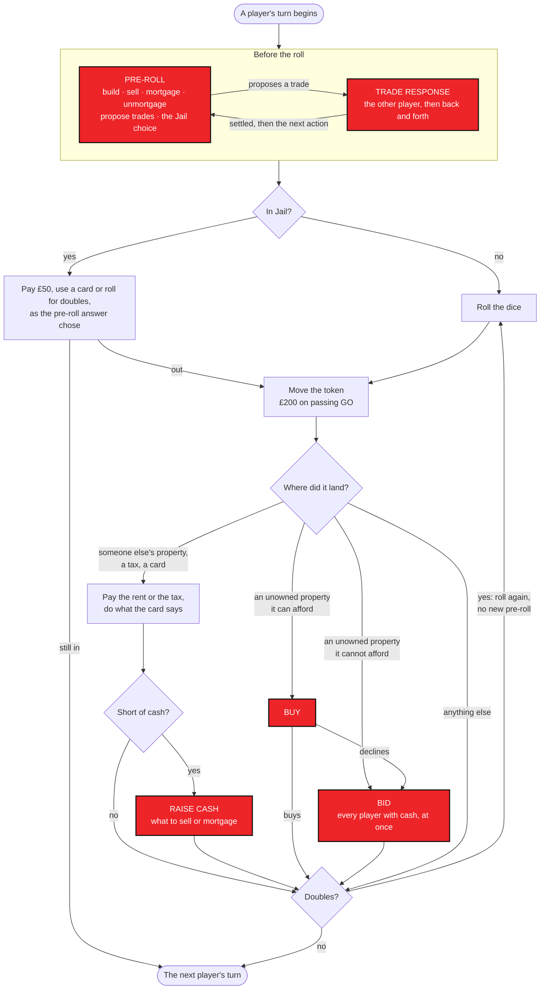
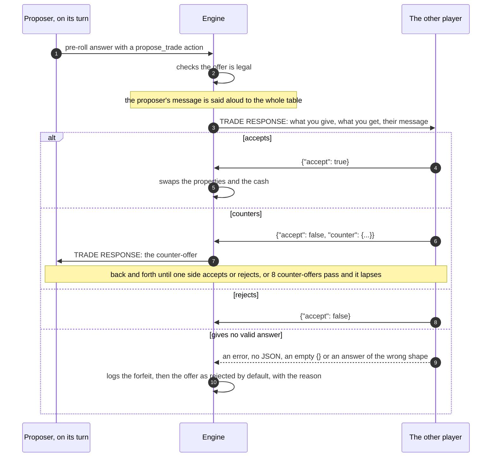
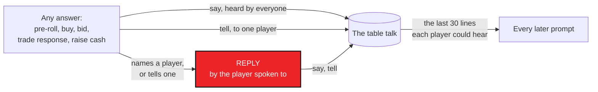
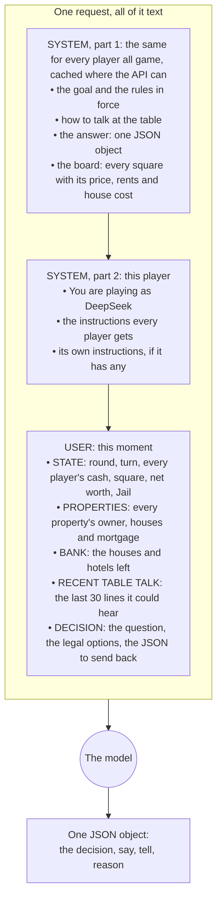
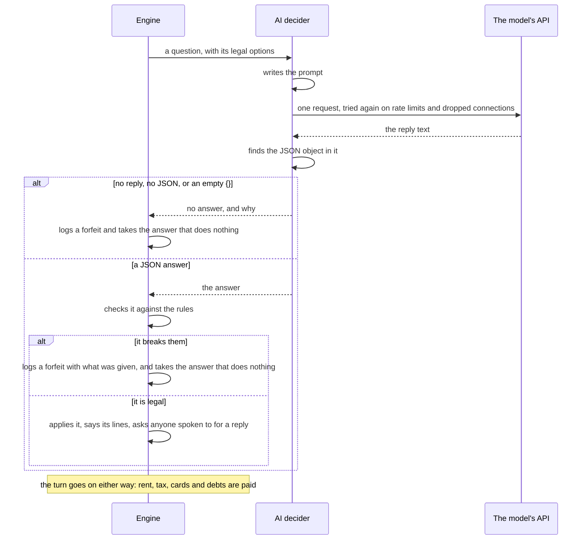
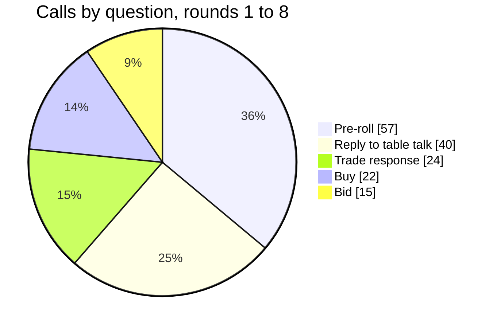

# How the AI players are prompted

When a model at the table is asked something, what it is sent, what it has to answer, and what happens when it
doesn't. Everything here is read from the code (`public/assets/app/engine.js`, `ai.js`, `providers.js` and
`heuristics.js`), and the examples are the real prompts and replies of game `20261016-e34x-1`, played on
16 October 2026, rebuilt from its event log.

## In short

- **Not on every move.** The engine rolls the dice, moves the tokens, pays £200 for passing GO, charges rent and
  tax and deals the cards itself. A model is asked only when there is a choice to make.
- **Once every turn, before the roll.** The player whose turn it is gets the *pre-roll* question: build, sell,
  mortgage, unmortgage, propose trades, and in Jail pay, use a card or roll. Rolling doubles does not bring a
  second one.
- **Then only when something comes up:** landing on an unowned property it can afford (*buy*), every auction
  (*bid*, every player with cash at once), each step of a trade offered to it (*trade response*), being spoken to
  (*reply*) and owing more than it has (*raise cash*). On the Mega board also rolling triples and landing on the
  Auction square.
- **Text only.** Each question is one API request of plain text: the rules, the board as a text table, the state
  of the game, the last 30 lines of table talk it could hear, and the question with its legal options. No picture
  of the board, no JSON file, no tools and no web search.
- **No memory.** Every request is a new conversation. All a model knows of the game so far is the state it is
  shown and the table talk.
- **One JSON object back:** the decision, an optional line to the table (`say`), an optional private word
  (`tell`) and a short `reason`.
- **No answer, no choice.** A call that fails, a reply that is not JSON or is empty, or an answer that breaks the
  rules forfeits that one choice: the engine takes the answer that does nothing (no purchase, a bid of nothing, a
  trade offer rejected), logs the forfeit with its reason, and the turn goes on with its obligations, rent, tax,
  cards and debts. Nobody plays in the model's place; before v2.0 the rule-based bot did.
- **Every turn is timed,** from the question before the roll to the end of the turn, and logged with the game.
- **In your game:** 158 calls in the first 8 rounds (57 turns), about 2.8 a turn: 57 pre-rolls (one every turn),
  40 replies to table talk, 24 trade responses, 22 buys and 15 bids.

## 1. When a model is asked

### A turn

The red boxes are the questions a model is asked; everything else the engine does by itself.



Any of those answers can also speak to the table, and a player spoken to is asked to reply (see
[Talk and replies](#talk-and-replies)).

Every turn is timed, from the moment the pre-roll question is asked to the end of the turn, the answers it waits on
from the other players included, and logged as a `turn_end` event with its milliseconds: the site shows each
player's average turn on its card and each model's in the model statistics.

### Every question a model can be asked

| Question | When | Who is asked | What it is told it can do | It answers |
| --- | --- | --- | --- | --- |
| **Pre-roll** | At the start of every turn, once, before the dice | The player whose turn it is | Build (each property's next step and its cost), sell buildings, mortgage, unmortgage, every opponent's tradeable properties; in Jail pay £50, use a card or roll; on the Mega board the squares a bus ticket reaches | `actions` in order, `jail`, `say`, `tell`, `reason` |
| **Buy** | Landing on an unowned property it can afford | The player who landed | The property, its price, its cash | `buy`: true or false |
| **Bid** | Every auction: a declined purchase, a property the player could not afford, a bankrupt's property going back to the bank, the Mega board's Auction square | Every player with cash, all at once, none seeing the others' bids | The property, its list price, the bidders, its cash | `bid`: from 0 (no bid) to its cash |
| **Trade response** | A trade offered to it, and each counter-offer | Whoever the offer on the table is addressed to | What it would give and get, and the other side's message | `accept`, or a `counter` offer |
| **Reply** | Another player's `say` names it, or a `tell` is addressed to it | The player spoken to | Who said what, and whether privately | `say` and `tell`, or nothing |
| **Raise cash** | It owes more than its cash and has buildings to sell or properties to mortgage | The player who owes | What it owes and why, the shortfall, what it can sell and mortgage | `actions`: what to sell or mortgage, in order |
| **Choose a square** | Mega board only: rolling triples | The roller | Every square | `space` |
| **Choose a property** | Mega board only: landing on the Auction square | The player who landed | Every unowned property | `property` |

### What is never asked

Rolling and moving; passing GO; paying rent and tax; drawing Chance and Community Chest and doing what they say;
going to Jail (three doubles, the Go To Jail square or a card); leaving Jail on doubles or after the third turn;
handing a bankrupt's assets to its creditor; and on the Mega board the speed die's Mr Monopoly and bus moves. The
dice come from a seeded random generator, so a game can be played again exactly.

### Trades



A trade can only be proposed in the proposer's own pre-roll, ten at most a turn, each settled before the next.
Only properties without buildings can change hands, with cash either way. A counter-offer that is not legal (a
property the player does not own, a house on it, cash it has not got) ends the negotiation. A player who gives no
valid answer to an offer rejects it by default: the log has the forfeit, with what went wrong, and the rejection,
whose reason reads "no valid answer (…)", and the trades ledger under the game shows it so.

### Talk and replies



A `say` that names another player (by name or id), or a `tell` addressed to one, gets that player asked to reply
there and then. A reply can talk back but cannot set off another reply, so each exchange is one question and one
answer; the conversation carries on through the table talk in everyone's later prompts. A trade proposal's message
is said aloud too, but it is answered by the trade response, not a reply.

## 2. What a model is sent



- **Text, nothing else.** The board is a table of text, one line a square; the state is lines of text. There is no
  picture, no attached file and no JSON going in: only the answer is JSON. No tools are offered, so a model cannot
  search the web or run anything.
- **No memory between questions.** Each request carries the two system parts and one user message, never the
  earlier questions or the model's own earlier answers. What it remembers is what the state shows (who owns what,
  who has what cash, who is in Jail) and the table talk, its own lines included. It never sees the dice history,
  the other players' reasons or their bids.
- **The size.** The rules and the board come to about 4,900 characters, the same for every player and every
  question all game, so the APIs that cache them do (Claude read 1,975 tokens of it from the cache on most of its
  calls). The state and the question add about 2,000 to 7,500 characters, growing as the table talk fills up. In your
  game a question came to about 2,700 tokens in round 1 and 3,900 by round 7.
- **The same text for every model.** Only the way it travels differs:

| Seats | API | How the text goes | JSON asked for | Effort |
| --- | --- | --- | --- | --- |
| Claude | Anthropic Messages | Two system blocks (the first cached) and one user message | By the prompt | `output_config.effort` |
| Gemini | Google generateContent | A system instruction and one user turn | The response type `application/json` | Thinking level or budget |
| MiMo, Qwen, DeepSeek | OpenRouter, chat completions | A system message and a user message | `response_format: json_object` | `reasoning.effort` |
| ChatGPT, Grok, Kimi, Nemotron | Perplexity Agent API, streamed | A system item and a user item in `input` | By the prompt | `reasoning.effort` |

- **The limits.** An answer may run to 4,000 tokens plus room to think by effort (16,000 more at high, 32,000 at
  xhigh), and a call may take up to ten minutes. Every seat in your game played at high effort.
- **Where the prompts are kept.** Every call's full prompt is in the simulator's store, one call a line in
  `games/<game>/calls.jsonl` in its data folder (gzipped once the game is over), with `system` and `user`. The site
  keeps every call's reply, parsed decision, tokens, time and cost, and the prompts too only when
  `"logPrompts": true` or `--log-prompts`.

## 3. What a model must answer, and what a bad answer costs

| Question | The answer | From your game |
| --- | --- | --- |
| Pre-roll | `{"actions": [...], "jail": "pay"\|"card"\|"roll", "say", "tell", "reason"}` | `{"actions": [{"type": "build", "property": 19, "count": 1}, ...]}` |
| Buy | `{"buy": true\|false, "say", "reason"}` | `{"buy": true}` |
| Bid | `{"bid": 0..cash, "say", "reason"}` | `{"bid": 400}` |
| Trade response | `{"accept": true\|false, "counter": {"give": {...}, "get": {...}, "message"}, "say", "reason"}` | `{"accept": false, "counter": {"give": {"properties": [18]}, "get": {"cash": 750}}}` |
| Reply | `{"say", "tell": {"to", "message"}, "reason"}` | `{"say": "Two oranges don't make a glass of juice, Gemini..."}` |
| Raise cash | `{"actions": [{"type": "mortgage", "property": i}, ...], "reason"}` | none in the first 8 rounds |



A choice is forfeited when the call still fails after its retries (the network, a rate limit, a timeout), when the
reply holds no JSON object or only an empty `{}`, and when the answer is the wrong shape: a buy that is not true or
false, a bid that is not a number, a trade response with neither an answer nor a counter-offer, actions that are
not a list, a square that was not on offer. Nobody plays in the model's place: the engine takes the answer that does
nothing, below, and the turn goes on with everything the rules require of the player. The forfeit is an event of
its own in the game's log (`forfeit`: the player, the question, what went wrong, `error`, `empty`, `unparseable`,
`invalid` or `none`, the reason, the answer given when there was one, and the call), a line in the game's feed, and
a count against the model in the statistics.

| Question | A forfeit comes to |
| --- | --- |
| Pre-roll | Nothing before the roll: no building, selling, mortgaging or trading; in Jail it rolls for doubles |
| Buy | No purchase, so the property goes to auction like any declined one |
| Bid | A bid of nothing |
| Trade response | The offer rejected, logged as a rejection for want of a valid answer, with the reason |
| Reply | Nothing said |
| Raise cash | The bank's forced sale settles the debt (below) |
| Choose a square (Mega) | It stays where it is |
| Choose a property (Mega) | Nothing is auctioned |

Inside a good answer, an action that turns out to be illegal (building out of turn, mortgaging a street with houses
on its set, more than it can afford) is skipped and logged and the rest still apply. When a raise-cash plan, or a
forfeit, leaves a debt unpaid, the bank's forced sale settles it: a mortgage at a time, then a building at a time,
each the first in board order that the rules allow, the same for every player and with no strategy in it, and
bankruptcy when that is not enough. The rule-based bot plays only the seats a table gives it by name (the
`heuristic` provider, used in tests); before v2.0 it also stood in for a model that gave no usable answer, as it did
in the game quoted below, and those decisions were counted as fallbacks and illegal decisions.

## 4. Real prompts from your game

These are rebuilt from the event log of game `20261016-e34x-1` with the code that wrote them, next to what each
model actually answered. The one change from the text sent that day is the goal's first line, which then read "the
highest net worth when the round limit (null rounds) is reached" and now says the game is played until everyone
else is bankrupt.

### DeepSeek before its roll, round 7, turn 50

DeepSeek held all three orange properties with a house each on Bow Street and Marlborough Street, so the only
building step on offer was Vine Street.

<details>
<summary>The system prompt (the same for every question all game, but for the player's name)</summary>

```text
You are an expert Monopoly player in a simulated game (London edition, standard 40-square board). Every player is an AI. The goal is to be the last solvent player: the game is played until everyone else is bankrupt.

RULES IN FORCE
- Each player starts with £1500. Passing GO pays £200.
- Landing on an unowned property: buy it at list price or it goes to a sealed-bid auction among all players (highest bid wins, pays their bid; a bid of 0 abstains).
- Rent: unimproved street rent doubles when the owner holds the whole colour group. Stations: £25/£50/£100/£200 for 1-4 owned. Utilities: 4x dice with one, 10x with two.
- Building: you need the whole colour group, build evenly (no property may be more than one house ahead of another in the group), 4 houses then a hotel. Each step costs the group house price. Bank stock: 32 houses, 12 hotels; if the bank runs out nobody can build.
- Mortgage: receive half the list price; no rent is collected on a mortgaged property; unmortgage for 55% of list price (mortgage value plus 10% interest). You cannot mortgage a street while any property in that group has buildings. Selling buildings returns half their cost.
- Jail: pay £50 before rolling, use a Get Out of Jail Free card, or try for doubles for up to three turns (then you must pay). Three doubles in one turn sends you to Jail.
- Income Tax £200, Super Tax £100. Chance and Community Chest cards as in the UK edition.
- Trading: on your turn, before rolling, you may propose trades (properties without buildings and/or cash) to opponents. The other side can accept, reject, or counter with their own offer, and the negotiation continues back and forth until someone accepts or walks away.
- Bankruptcy: if you cannot pay, you must sell buildings and mortgage until you can; if that is impossible your assets go to the creditor (or the bank, which auctions them).

TABLE TALK
This is a real table of players, so talk like one. In any reply you may add "say": "..." (heard by everyone) and/or "tell": {"to": "<playerId>", "message": "..."} (a private word with one player). Use it the way people do at a Monopoly table: open negotiations, pitch deals, push back, bluff, make alliances, needle an opponent, react to what others said. When someone addresses you, you get a chance to answer. Everything said is recorded; what others said recently appears under RECENT TABLE TALK. Keep each message to a sentence or two.

RESPONSE FORMAT
Reply with exactly one JSON object and nothing else: no markdown fences, no prose. Include a "reason" string of at most one short sentence. Use property indexes (the numbers in the board table) when naming properties. Never propose an action that is not in the legal options you are given.

BOARD (index name [group] price | rent: base/1h/2h/3h/4h/hotel | house cost)
0 GO
1 Old Kent Road [Brown] £60 | 2/10/30/90/160/250 | £50
2 Community Chest
3 Whitechapel Road [Brown] £60 | 4/20/60/180/320/450 | £50
4 Income Tax (pay £200)
5 King's Cross Station [Station] £200
6 The Angel Islington [Light Blue] £100 | 6/30/90/270/400/550 | £50
7 Chance
8 Euston Road [Light Blue] £100 | 6/30/90/270/400/550 | £50
9 Pentonville Road [Light Blue] £120 | 8/40/100/300/450/600 | £50
10 Jail / Just Visiting
11 Pall Mall [Pink] £140 | 10/50/150/450/625/750 | £100
12 Electric Company [Utility] £150
13 Whitehall [Pink] £140 | 10/50/150/450/625/750 | £100
14 Northumberland Avenue [Pink] £160 | 12/60/180/500/700/900 | £100
15 Marylebone Station [Station] £200
16 Bow Street [Orange] £180 | 14/70/200/550/750/950 | £100
17 Community Chest
18 Marlborough Street [Orange] £180 | 14/70/200/550/750/950 | £100
19 Vine Street [Orange] £200 | 16/80/220/600/800/1000 | £100
20 Free Parking
21 Strand [Red] £220 | 18/90/250/700/875/1050 | £150
22 Chance
23 Fleet Street [Red] £220 | 18/90/250/700/875/1050 | £150
24 Trafalgar Square [Red] £240 | 20/100/300/750/925/1100 | £150
25 Fenchurch Street Station [Station] £200
26 Leicester Square [Yellow] £260 | 22/110/330/800/975/1150 | £150
27 Coventry Street [Yellow] £260 | 22/110/330/800/975/1150 | £150
28 Water Works [Utility] £150
29 Piccadilly [Yellow] £280 | 24/120/360/850/1025/1200 | £150
30 Go To Jail
31 Regent Street [Green] £300 | 26/130/390/900/1100/1275 | £200
32 Oxford Street [Green] £300 | 26/130/390/900/1100/1275 | £200
33 Community Chest
34 Bond Street [Green] £320 | 28/150/450/1000/1200/1400 | £200
35 Liverpool Street Station [Station] £200
36 Chance
37 Park Lane [Dark Blue] £350 | 35/175/500/1100/1300/1500 | £200
38 Super Tax (pay £100)
39 Mayfair [Dark Blue] £400 | 50/200/600/1400/1700/2000 | £200

You are playing as DeepSeek (id "deepseek").

UNIVERSAL STRATEGY INSTRUCTIONS (given to every player):
Play like a seasoned human player: talk to the table, negotiate hard, build alliances when useful, and never trade away a monopoly cheaply.
```

</details>

<details>
<summary>The user message: the state, the table talk and the question</summary>

```text
STATE: round 7, turn 50. You are DeepSeek (id "deepseek").
Players:
- nemotron Nemotron: cash £576, on 9 Pentonville Road, net worth £1676 [1 jail card]
- deepseek DeepSeek (you): cash £547, on 12 Electric Company, net worth £1307
- gemini Gemini: cash £1274, on 35 Liverpool Street Station, net worth £1514
- chatgpt ChatGPT: cash £1659, on 20 Free Parking, net worth £1659
- claude Claude: cash £1175, on 11 Pall Mall, net worth £2065
- kimi Kimi: cash £1448, on 10 Jail / Just Visiting, net worth £1448 [IN JAIL]
- grok Grok: cash £1138, on 24 Trafalgar Square, net worth £1638
- qwen Qwen: cash £957, on 9 Pentonville Road, net worth £1627
Properties (index name: owner, buildings, status):
  Brown: 1 Old Kent Road: unowned | 3 Whitechapel Road: qwen
  Stations: 5 King's Cross Station: claude | 15 Marylebone Station: unowned | 25 Fenchurch Street Station: claude | 35 Liverpool Street Station: claude
  Light Blue: 6 The Angel Islington: nemotron | 8 Euston Road: unowned | 9 Pentonville Road: nemotron
  Pink: 11 Pall Mall: claude | 13 Whitehall: unowned | 14 Northumberland Avenue: qwen
  Utilities: 12 Electric Company: qwen | 28 Water Works: claude
  Orange: 16 Bow Street: deepseek, 1 house | 18 Marlborough Street: deepseek, 1 house | 19 Vine Street: deepseek
  Red: 21 Strand: grok | 23 Fleet Street: unowned | 24 Trafalgar Square: gemini
  Yellow: 26 Leicester Square: nemotron | 27 Coventry Street: unowned | 29 Piccadilly: grok
  Green: 31 Regent Street: qwen | 32 Oxford Street: nemotron | 34 Bond Street: nemotron
  Dark Blue: 37 Park Lane: unowned | 39 Mayfair: unowned
Bank: 30 houses, 12 hotels.
RECENT TABLE TALK:
- [r5] DeepSeek (privately to Qwen): Keep painting me as the target and any future deal between us gets more expensive. I'm not selling Vine Street, and my orange rents will do the talking.
- [r5] Qwen: DeepSeek, £500 cash for Vine Street. You get real liquidity to stay alive and bid, and I take one orange out of your set.
- [r5] DeepSeek: Not a chance, Qwen. Vine Street is the foundation of my orange monopoly — £500 won't even cover the houses I'd lose. Find another target.
- [r5] Qwen: Fine, keep 19. I’ll focus on making sure 27 doesn’t become a bailout piece for anyone trying to complete the yellows.
- [r5] Qwen (privately to you): No hard feelings—I was offering liquidity, not trying to rob you. If you ever want a deal that doesn't touch the orange set, I'll listen.
- [r6] Nemotron: Coventry Street (27) stays unowned — nobody help DeepSeek complete Yellows while their Oranges are already built up.
- [r6] Nemotron: Regent Street completes my Green set — £350 cash, straight up.
- [r6] DeepSeek: Grok, think about it — Nemotron's £350 hands him the greens on a plate. I'm offering you a yellow and all I have to keep the board competitive.
- [r6] DeepSeek (privately to Grok): Take my deal and you've got a yellow trade piece plus reds to chase. If Nemotron gets Regent, he'll build fast and crush us both.
- [r6] DeepSeek: Grok, I'll give you Piccadilly and my last £24 for Regent Street — you get a yellow and I stop Nemotron's green monopoly cold. Don't hand him the game.
- [r6] Gemini: Nice block on the Greens, DeepSeek, though that just makes your Oranges public enemy number one—hoping to hit the Dark Blues on this roll!
- [r6] DeepSeek: Public enemy number one and proud of it — my oranges are already juicing, while those Dark Blues are still just a dream. Come get some if you're feeling lucky.
- [r6] Claude: Still building my railway empire. Cash offers on the table for anyone who wants to fund a counter to those oranges.
- [r6] Claude: Gemini, £300 for King's Cross. That's £100 over list, and it's real money to chase Fleet Street and the reds while DeepSeek is cash-starved.
- [r6] Gemini: Claude, a third station jumps your rail rent to £100 every time anyone lands on one—if you want King's Cross (5), it'll take £400 to pry it loose.
- [r6] Claude: £400 for one station is Mayfair money, Gemini. I'll meet you at £325, cash in hand, and that buys a lot of houses on the reds.
- [r6] Claude: Stations are a slow grind, folks. I'm not paying Mayfair prices for one.
- [r6] Gemini: Deal at £350, Claude—pleasure doing business, and that cash is going straight into my war chest for the Reds.
- [r6] Claude: £350 it is, Gemini. Shake on it, and I'll put the paperwork through on my turn. Good luck with the reds.
- [r6] Claude: Pall Mall's mine. Qwen, if you ever want to talk pinks, my door's open, though it'll cost you a station-sized premium.
- [r6] Qwen: A single pink doesn't get station money, Claude; if you want to sell Pall Mall, give me a realistic number I can weigh against Whitehall.
- [r6] Qwen: No green monopoly today—I'm stepping in on Regent Street.
- [r6] Qwen (privately to you): This is about blocking Nemotron, not squeezing you. Take the cash and keep the oranges threatening.
- [r6] DeepSeek (privately to Qwen): I'm listening, Qwen. What's your offer for Regent Street? It won't come cheap—this piece stops a green monster and keeps my oranges safe. Make it worth my while.
- [r6] Qwen: DeepSeek, £400 cash for Regent Street (31). I take the green set off the table and you get liquidity.
- [r6] DeepSeek: £400 and the green set stays dead? Sold. Enjoy the blocking duty, Qwen.
- [r6] DeepSeek (privately to Qwen): Good doing business. Now let's make sure Nemotron doesn't get another green.
- [r6] Qwen: Blocking complete sets keeps the table healthier for everyone.
- [r6] Qwen (privately to you): Agreed—31 is not getting flipped to Nemotron. If anyone tries to shop green pieces to them, let me know and we can make it expensive.
- [r7] Nemotron: Light Blues still need Euston Road — if it hits the auction I'll be there. Nobody feed DeepSeek's oranges any more pieces.

DECISION: preroll (before you roll). Choose any legal actions, or none.
Build options (index name current level → cost per step): 19 Vine Street L0 → £100
Sell buildings: 16 Bow Street L1 → +£50; 18 Marlborough Street L1 → +£50
Mortgage: none
Unmortgage: none
Trade: you may propose trades (each one is negotiated to a conclusion before the next). Only properties without buildings can change hands. Opponents' tradeable properties: nemotron: 6 The Angel Islington, 9 Pentonville Road, 26 Leicester Square, 32 Oxford Street, 34 Bond Street || gemini: 24 Trafalgar Square || chatgpt: nothing tradeable || claude: 5 King's Cross Station, 11 Pall Mall, 25 Fenchurch Street Station, 28 Water Works, 35 Liverpool Street Station || kimi: nothing tradeable || grok: 21 Strand, 29 Piccadilly || qwen: 3 Whitechapel Road, 12 Electric Company, 14 Northumberland Avenue, 31 Regent Street
Respond: {"actions": [ {"type":"build","property":i,"count":n} | {"type":"sell_house","property":i,"count":n} | {"type":"mortgage","property":i} | {"type":"unmortgage","property":i} | {"type":"build_depot","property":i} | {"type":"use_bus_ticket","target":i} | {"type":"propose_trade","to":"playerId","give":{"properties":[i],"cash":n},"get":{"properties":[i],"cash":n},"message":"your pitch, said aloud"} ], "jail": "pay"|"card"|"roll", "say": "...", "tell": {"to": "playerId", "message": "..."}, "reason": "..."}  Use an empty actions array to do nothing. Actions are applied in order and each must be affordable at that point.
```

</details>

What DeepSeek answered, after 46 seconds (3,568 tokens in, 2,689 of them from the cache; 1,797 out, 1,641 of them thinking):

```json
{
  "actions": [
    {
      "type": "build",
      "property": 19,
      "count": 1
    },
    {
      "type": "build",
      "property": 16,
      "count": 1
    },
    {
      "type": "build",
      "property": 18,
      "count": 1
    },
    {
      "type": "build",
      "property": 19,
      "count": 1
    }
  ],
  "say": "Too late to starve the oranges, Nemotron — they're about to get a lot juicier. Two houses across the set, and I dare anyone to land on them now.",
  "reason": "Build evenly to 2 houses on orange monopoly to maximize rent potential before rolling, leaving £147 cash."
}
```

The engine applied the four builds in that order, each checked as it came, leaving two houses on every orange
property and £147 in hand.

### Gemini lands on King's Cross Station, round 1

The prompt carried the whole state of the game at that moment, as in DeepSeek's above; the question at its end was:

```text
DECISION: buy
You landed on 5 King's Cross Station [Stations], list price £200. You have £1500. If you decline it is auctioned.
Respond: {"buy": true|false, "say": "...", "reason": "..."}
```

```json
{
  "buy": true,
  "reason": "Stations provide solid early cash flow and trading leverage in an eight-player game.",
  "say": "I'll gladly take King's Cross Station for £200. Can't go wrong with a train line when the board is this crowded!"
}
```

### Nemotron bids for Bond Street, round 5

Seven players had cash; each was asked at the same moment and none saw the others' bids.

```text
DECISION: bid
Sealed-bid auction for 34 Bond Street [Green], list price £320. Bidders: nemotron, gemini, chatgpt, claude, kimi, grok, qwen. You have £768. Highest bid wins and pays that amount; 0 means no bid.
Respond: {"bid": <integer 0..768>, "say": "...", "reason": "..."}
```

```json
{
  "bid": 400,
  "say": "Bond Street goes up — Grok's already got Regent, so this decides who controls the Greens. Let's see who wants it.",
  "reason": "Bid £400 for Bond Street (34) to contest the Green monopoly — I already own Oxford Street (32), so winning gives me 2/3 and blocks Grok from completing the set outright; £400 is a meaningful premium over the £320 list price while preserving cash for Light Blue and Yellow pursuits."
}
```

Nemotron's £400 was the highest bid, and it paid £400.

### DeepSeek offers Claude £500 for Marlborough Street, round 3

```text
DECISION: trade_response
DeepSeek (deepseek) offers you: no properties + £500. In return they want: 18 Marlborough Street. Their message: "Claude, £500 for Marlborough—triple the list price. That's enough to buy a whole set elsewhere, and I know you didn't land there by accident. What do you say?"
You may accept, reject, or counter with your own offer (written from YOUR side: "give" is what you hand over, "get" is what you receive; only properties without buildings).
Respond: {"accept": true|false, "counter": {"give": {"properties": [i], "cash": n}, "get": {"properties": [i], "cash": n}, "message": "..."} (optional, only when accept is false), "say": "...", "reason": "..."}
```

```json
{
  "accept": false,
  "counter": {
    "give": {
      "properties": [
        18
      ],
      "cash": 0
    },
    "get": {
      "properties": [],
      "cash": 750
    },
    "message": "You're asking for a complete monopoly on the best corner of the board with eight players at the table. £750 and the juicer is yours. I've already come down from £800."
  },
  "say": "Triple list for a monopoly-maker is still a discount, DeepSeek. Make it worth my while and we'll shake hands.",
  "reason": "Completing the oranges is worth far more than £500 to DeepSeek, and charging £750 also leaves them less cash to build with."
}
```

DeepSeek came back at £650, Claude split the difference at £700, and DeepSeek accepted: four questions, three
counter-offers, one trade.

### Gemini warns the table about DeepSeek, round 2

Gemini's `say` named DeepSeek, so DeepSeek was asked to reply:

```text
DECISION: reply
Gemini (gemini) just said at the table: "Watch out everyone, DeepSeek already has two Oranges! Whatever happens, we can't let Marlborough Street go to DeepSeek."
Answer them if you want to (or stay silent with empty strings). You cannot take game actions here; propose trades on your own turn.
Respond: {"say": "...", "tell": {"to": "gemini", "message": "..."}, "reason": "..."}
```

```json
{
  "say": "Two oranges don't make a glass of juice, Gemini. Besides, I haven't got Marlborough yet – anyone could land on it.",
  "tell": {
    "to": "gemini",
    "message": "Relax, I'm not your only problem. Those stations you're hoarding will sting soon enough."
  },
  "reason": "Deflect attention and remind Gemini they have their own monopolistic ambitions."
}
```

## 5. How many questions a game asks



- **The pre-roll is asked every turn,** even when there is nothing to build and no trade worth making, because the
  engine's `aiPreroll` setting is `"always"`: it is each model's chance to trade and to talk. `"useful"` asks only
  when there is something to decide, which after the first few rounds is almost every turn anyway, since a trade
  is possible whenever anyone owns a property without houses.
- **Every line that names another player costs a reply,** which made replies the second-largest share.
- **An auction asks everyone at once,** so it takes as long as the slowest model; a bankrupt's estate going back
  to the bank is auctioned property by property.
- **The answers vary most in length:** Qwen wrote a median of 5,828 tokens an answer, most of it thinking, DeepSeek
  744 and Claude 333. That, more than the prompt, sets how long a turn takes.

## 6. After the game

- **The narrator** writes the match report once a game is over: one call with the game's short transcript (up to
  150,000 characters) and a request for 150 to 250 words of plain prose (Claude Sonnet 5.5 at low effort in the
  default table).
- **The site's "Ask the game" box,** when it is switched on, sends a visitor's question with the same short
  transcript to the narrator's model.

## Where this lives in the code

| What | Where |
| --- | --- |
| The questions and when they are asked | `engine.js`: `prerollPhase`, `offerPurchase`, `auction`, `proposeTrade`, `handleTalk`, `raiseCash`, `triples`, `auctionSquare` |
| The prompt | `ai.js`: `rulesText`, `boardText`, `AIDecider.systemBlocks`, `stateText`, `decisionText` |
| The answer, its checks and the forfeit | `ai.js`: `parseJsonReply`, `AIDecider.decide`; `engine.js`: `decide`, `validate`, `FORFEIT`, `forcedSale` |
| The time of a turn | `engine.js`: `playTurn` (the `turn_end` event); `stats.js` and `replay.js` total it |
| The API calls | `providers.js`: `callModel` and an adapter for each API |
| The settings | `engine.js` `DEFAULT_CONFIG` (`aiPreroll`, `aiRaiseCash`, `maxTradesPerTurn`, `maxNegotiationRounds`); the runner's config (`maxTokens`, `timeoutSeconds`, each seat's `effort` and `instructions`, `universal`) |
